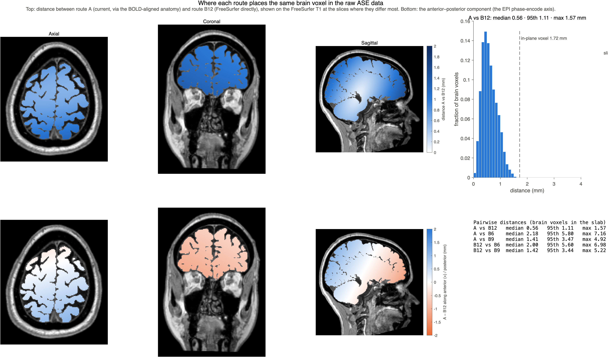
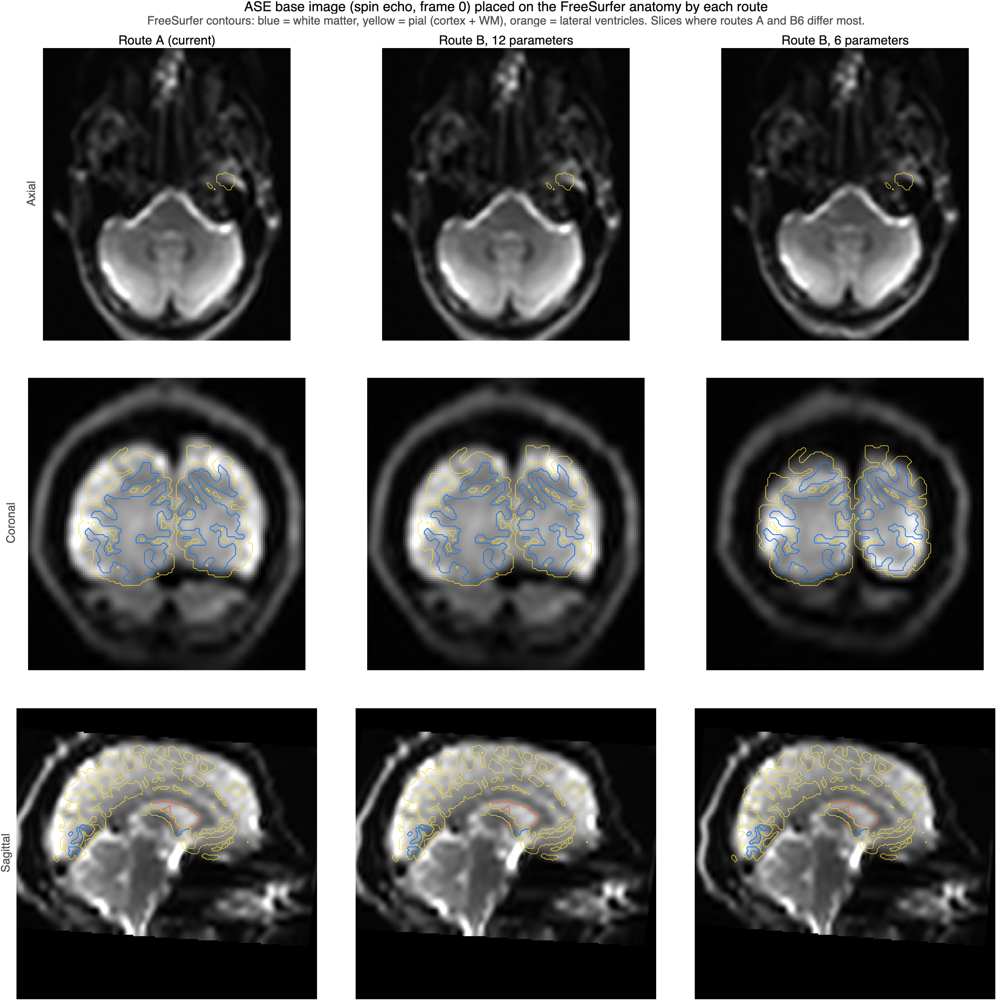
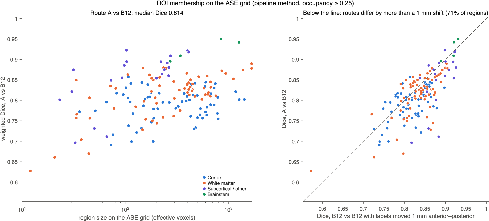
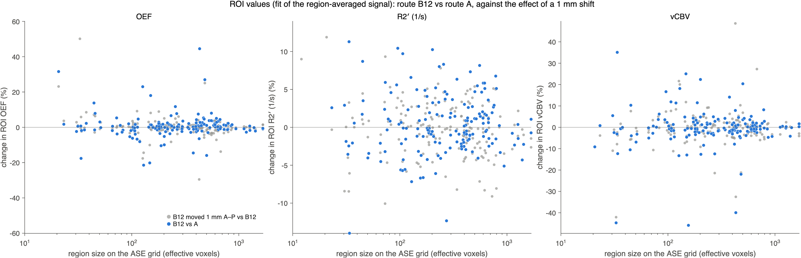
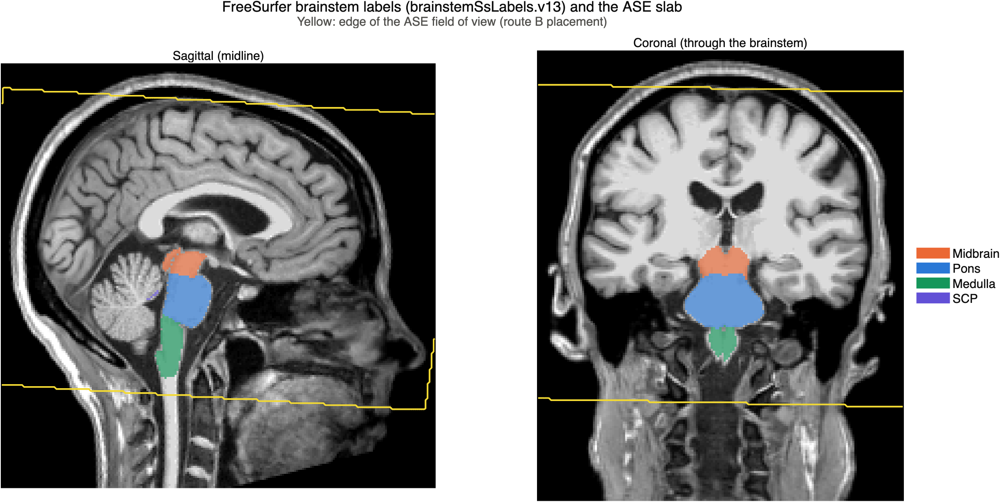

# Anatomy for the ASE pipeline: from `session_afni_nortc` to FreeSurfer directly

**Status:** adopted 2026-11-24 (`anatSource = fsrecon`, `registerDof = 12` with 9 or 6 as options; brainstem labels keep overlapping aseg). Evidence from one subject (`bch046_250816`). The cohort's preprocessing is to be rerun with it before calibration.

**Question:** the ASE pipeline gets its anatomy (registration target, ROI segmentations, CSF fraction) from `session_afni_nortc`, which the o2co2 BOLD pipeline builds. Can it take the same information directly from the FreeSurfer recon (`fsrecon/<subj>/mri`) instead, and what changes if it does?

## Summary

1. **The current anatomy is FreeSurfer, moved into the BOLD frame.** `session_afni_nortc` comes from `clusterFiles/batch_afni_o2co2_kwong_240114_rs_nortc_ForSam`. It converts FreeSurfer's `T1.mgz`, `aseg`, `aparc+aseg` and `wmparc`, then moves them into the frame of the BOLD base (resting BOLD frame 0, deobliqued). It does this with a zero-pad, a centre shift and a 12-parameter affine. Rebuilding that chain from the FreeSurfer files reproduces the stored `anat_fs_aparc_aseg_al` in all but 21 of 1,144,451 voxels. Nothing else feeds into it.
2. **Registering the ASE directly to FreeSurfer with 12 parameters gives the same geometry as today.** Route A (current) and route B12 (FreeSurfer, 12 parameters) place each brain voxel in the raw ASE data within 0.56 mm of each other (median; 95th percentile 1.1 mm, max 1.6 mm). That is a third of an in-plane ASE voxel. ROI values move by about as much as they do when the labels are shifted by 1 mm (OEF: median 1.6% vs 1.4%; no systematic bias).
3. **A rigid registration (6 parameters) is not enough for this subject.** Compared with the T1, the ASE image is about 3–4% shorter along anterior–posterior (the EPI phase-encode axis) and slightly shorter superior–inferior. A rigid fit can't absorb that, so it misplaces the occipital and frontal poles by up to 7 mm (Fig. 2).
4. **Route A carries a measurable cost of its own: extra resampling.** Its labels are resampled with nearest neighbour twice (into the BOLD frame, then into ASE space) instead of once. On the ASE grid, the extra step alone changes ROI masks as much as a 1 mm shift: the stored masks vs the same transform applied in one step give a median Dice of 0.85, against 0.84 for a 1 mm shift. It also changes the CSF > 0.2 flag (quality bit 4) in 4.5% of voxels.
5. **Route B also gives the brainstem directly.** FreeSurfer's brainstem labels (midbrain, pons, medulla) need no extra processing in route B. In route A they had to be pushed through the same BOLD chain by hand, which was done only for bch046. All three lie entirely inside the ASE slab.
6. **Dependence:** route B needs only the raw DICOMs and the FreeSurfer recon. Route A also needs a BOLD run and the BOLD pipeline's processing of it. For bch045, that BOLD run was acquired two days after the ASE and T1.

**Recommendation:** replace `session_afni_nortc` with the FreeSurfer recon. Keep a 12-parameter registration, the same as today. Before committing to 12 parameters for the cohort, check on a few more subjects that the 3–4% anterior–posterior scaling is consistent. Details under [Recommendation and decisions](#recommendation-and-decisions).

## 1. The two routes

**Route A, current** (`batch_afni_…_ForSam`: `DOanatread`, `DOboldbase`, `DOregister`, `DOaparcaseg`, `DOwmparc`, `DOboldmask`; then `asePreProcess.sh` stages 5–8):

```
FreeSurfer (T1, aseg, aparc+aseg, wmparc: 256³, 1 mm)
  │ mri_convert; 3dZeropad -S 20 -I -20 (box moved 20 mm up, nothing lost on this subject)
  │ @Align_Centers to bold_base → anat_fs_shft.1D (translation; labels: NN resample #1)
  │ 3dAllineate to bold_base, lpa+, 12 parameters → anat_fs_brain_al_mat (labels: NN resample #2)
  ▼  "_al" space = the BOLD frame (rest run frame 0, deobliqued)
  │ asePreProcess stage 6: ase_base → anat_fs_brain_al, lpa+, 12 parameters
  │ stage 7: inverse, NN onto a 1 mm grid (labels: NN resample #3)
  ▼  ASE space → segToAseMembership (occupancy ≥ 0.25)
```

**Route B, proposed:**

```
FreeSurfer (T1, aseg, aparc+aseg, wmparc, brainstemSsLabels.v13.FSvoxelSpace: one 256³ grid)
  │ mri_convert only
  │ target = T1 × step(aseg), 3dUnifize (the old target's recipe, minus the BOLD step)
  │ ase_base → target, lpa+ (same allineateOpts as today), 6 / 9 / 12 parameters
  │ inverse, NN onto a 1 mm grid (labels: NN resample #1, the only one)
  ▼  ASE space → segToAseMembership (unchanged)
```

Route A's two affines combine into a single affine. So route B with 12 parameters can represent the same overall transform as route A; the differences come from what each registration sees, and from resampling.

## 2. Provenance checks

| check | result |
|---|---|
| FreeSurfer `T1.mgz` (mri_convert) vs `session_afni_nortc/anat_fs_orig.nii` | identical (0 voxels differ); also `aseg`, `wmparc` |
| zero-pad + centre shift replayed on `aparc+aseg` vs stored `anat_fs_aparc_aseg.nii` | 0 voxels differ |
| full chain replayed vs stored `anat_fs_aparc_aseg_al` | 21 of 1,144,451 labelled voxels differ (NN rounding ties, AFNI 22.1 vs 26.2) |
| stored `session_ase/anat_fs_bstem_al.nii.gz` (made by hand on the cluster, 2026-11-12) vs the replayed chain on the FreeSurfer brainstem labels | 1 voxel differs |
| labelled voxels lost to the 20 mm inferior crop | 0 |
| anatomy → BOLD affine (`anat_fs_brain_al_mat`) | det 0.968, singular values 1.000 / 0.996 / 0.972 (volume −3.2%) |
| brainstem labels, FreeSurfer vs after the route-A chain | 23,071 → 23,736 voxels (+2.9%) |
| FreeSurfer recon (`scripts/recon-all.cmd`) | FreeSurfer 7.4.1, T1 only (no FLAIR), input `nii/anat_011.nii` |

## 3. Registration parameters

All routes are scored against the same reference: the unifized FreeSurfer T1 brain, with the ASE base resampled into it. AFNI scale order is x = right–left, y = anterior–posterior, z = inferior–superior.

| route | det | scales (x, y, z) or singular values | shears | lpa+ | lpc | nmi |
|---|---|---|---|---|---|---|
| A (current, combined) | 0.934 | SV 1.007 / 0.992 / 0.936 | — | **1.188** | **−0.320** | 0.980 |
| B6 (rigid) | 1 | 1 / 1 / 1 | — | 1.292 | −0.166 | **0.972** |
| B9 | 0.904 | 0.983 / **0.956** / 0.963 | — | 1.229 | −0.295 | 0.983 |
| B12 | 0.939 | 0.989 / **0.968** / 0.982 | 0.072 (z/y) | **1.189** | **−0.317** | 0.979 |

Lower is better for all three costs. lpa+ is the cost the pipeline optimizes, and B was optimized against exactly this target. lpc (local Pearson) agrees with lpa+. nmi is a global measure; it prefers the rigid fit by a small margin and is less sensitive to edge alignment.

- With 9 or 12 free parameters, the fit compresses the ASE by about 3–4% along anterior–posterior relative to the T1, and somewhat along superior–inferior. Route A's combined transform does the same (smallest singular value 0.936).
- Anterior–posterior is the phase-encode direction of this EPI (`j-`, 15.9 Hz per pixel; see the acquisition note in [decisions.md](decisions.md)). A global field offset or gradient along phase encode stretches or compresses the image along that axis, so a consistent scaling there is plausible.

## 4. Geometry



*Fig. 1. For every FreeSurfer brain voxel: the distance between the raw-ASE positions routes A and B12 assign to it. Computed by pushing an ASE index image through each route's own matrices with AFNI. Bottom row: the anterior–posterior component. (Generated with `mainDof = 12`; the first version of this figure compared A with B6, and its smooth front-to-back gradient up to 7 mm is what flagged the scaling.)*

| pair | median | 95th | max (mm) | median per axis R / A / S |
|---|---|---|---|---|
| **A vs B12** | **0.56** | **1.11** | **1.57** | 0.22 / 0.37 / 0.24 |
| A vs B9 | 1.41 | 3.47 | 4.92 | 0.26 / 1.11 / 0.59 |
| A vs B6 | 2.18 | 5.80 | 7.16 | 0.23 / 2.08 / 0.60 |
| B12 vs B9 | 1.42 | 3.44 | 5.22 | 0.16 / 1.24 / 0.54 |
| B12 vs B6 | 2.00 | 5.60 | 6.98 | 0.28 / 1.86 / 0.63 |

ASE voxel: 1.72 × 1.72 × 4.8 mm. The whole FreeSurfer brain lies inside the ASE slab for every route.

- Where A and B12 differ most is the frontal pole and orbitofrontal cortex: a median of 1.1–1.5 mm (full list in `figures/anat_route/summary.txt`). That is the region with the strongest susceptibility distortion, where an affine is least determined.
- Where A and B6 differ most is the occipital pole: lateral occipital, pericalcarine, lingual and cuneus, with medians of 4.3–5.8 mm.



*Fig. 2. ASE base image (spin echo, frame 0) placed on the FreeSurfer anatomy by route A, route B12 and route B6 (rigid), at the slices where A and B6 differ most. Coronal row, through the occipital lobe: A and B12 place the same ASE cross-section under the anatomy, and FreeSurfer's pial (yellow) and white-matter (blue) contours follow the ASE brain outline. The rigid fit samples a cross-section several millimetres more posterior, and the contours no longer match the ASE brain's shape. That is the 3–4% anterior–posterior compression a rigid registration can't absorb.*

## 5. ROI membership on the ASE grid

ROI membership is computed the way the pipeline does it (`segToAseMembership`, occupancy ≥ 0.25), using the LUT `GM_WM_long.txt` with aparc+aseg, wmparc and the brainstem labels. The table reports weighted Dice over 163 regions.

| comparison | median Dice | what it measures |
|---|---|---|
| B12 vs B12 with labels moved 1 mm anterior–posterior | 0.838 | reference: how strict this metric is |
| A as stored vs A's transform applied in one NN step | 0.846 | **route A's extra resampling only** |
| A's transform (one step) vs B12 | 0.876 | **the transform only** |
| A as stored vs B12 | 0.814 (IQR 0.779–0.846) | the whole change |
| B12 vs B9 / B12 vs B6 | 0.781 / 0.727 | the parameter count |



*Fig. 3. Left: Dice, A vs B12, per region against region size. Right: against the 1 mm reference. Points below the diagonal changed more than a 1 mm shift would change them (71% of regions). Most of that comes from route A's extra resampling, not from the transform.*

**Tissue fraction for the CSF criterion** (quality bit 4, CSF = 1 − xvent): 81,462 ASE voxels with tissue in either route.

| comparison | mean \|Δ fraction\| | CSF > 0.2 flag differs |
|---|---|---|
| A as stored vs B12 | 0.070 | 7.7% of voxels |
| of which: resampling only | 0.041 | 4.5% |
| of which: transform only | 0.060 | 6.6% |

Route A's xvent mask is a binary mask that has already been resampled twice (NN) before it is averaged onto the ASE grid. In route B it's computed on FreeSurfer's own grid and resampled once (linear), so its partial-volume fractions are cleaner.

## 6. ROI values

A stats-only fit with default settings (quality mask off) on the same motion-corrected data. Only the ROI membership changes between runs. The table gives the median and 90th percentile of the relative change across ROIs.

| stat | B12 vs A | signed median | reference: B12 moved 1 mm A–P | B6 vs B12 | B9 vs B12 |
|---|---|---|---|---|---|
| OEF | 1.6% (10.3%) | +0.2% | 1.4% (7.1%) | 2.9% | 2.6% |
| R2′ | 2.2% (6.7%) | −0.1% | 2.2% (5.8%) | 4.1% | 3.7% |
| vCBV | 2.2% (12.6%) | −0.4% | 2.4% (10.1%) | 5.2% | 3.7% |
| R2 | 1.0% (3.7%) | +0.3% | 1.0% (4.2%) | 2.2% | 1.5% |

ROIs with finite, positive OEF: A 158, B12 157 (of 163). Full per-ROI table: `figures/anat_route/roi_values.csv`.



*Fig. 4. Change in ROI OEF, R2′ and vCBV, B12 vs A (blue), against the change from moving B12's labels 1 mm (grey). Large relative changes occur only in small regions, for both.*

Switching to route B12 shifts ROI values by about as much as a 1 mm change in label placement, with no systematic bias. Choosing 6 or 9 parameters instead would change values about twice as much.

## 7. Brainstem

| label | volume (mm³) | inside ASE slab | inside aseg Brain-Stem (16) | ASE voxels, A / B12 | Dice A vs B12 |
|---|---|---|---|---|---|
| Midbrain (173) | 5,247 | 100% | 55% | 346 / 342 | 0.909 |
| Pons (174) | 13,116 | 100% | 83% | 838 / 847 | 0.950 |
| Medulla (175) | 4,475 | 100% | 95% | 282 / 273 | 0.896 |
| SCP (178) | 233 | 100% | 29% | not in the LUT | — |



*Fig. 5. FreeSurfer brainstem labels and the edge of the ASE slab.*

The labels overlap aseg: the midbrain extends into ventral DC (aseg 28 / 60), and the pons into cerebellar white matter. With the pipeline's `keepOverlaps = true`, those voxels count towards both ROIs. Decide whether that's wanted (see below).

## Recommendation and decisions

**Recommended:** route B with 12 parameters, as an option in `asePreProcess.sh` (`anatSource = fsrecon`, keeping `afni` for one round so old results can be reproduced).

What it buys:
- no dependence on the BOLD pipeline or the BOLD acquisition;
- one resampling step instead of three, so cleaner ROI masks and CSF fractions;
- brainstem ROIs with no extra processing;
- the same geometry as today (median 0.56 mm), so earlier single-subject conclusions stand.

**Decisions needed:**
1. **Parameter count: 12 (recommended) vs 9.** Both capture the anterior–posterior compression. 12 also adds a shear of 0.07 (z/y), which matches today's combined transform. Check the fitted scales on 3–5 more subjects. If the anterior–posterior scale is consistently 0.95–0.97, it's a property of this acquisition, and 9 or 12 is justified. If it varies widely, look at the outliers before choosing.
2. **Brainstem overlap with aseg** (midbrain / ventral DC, pons / cerebellar WM): keep both (current behaviour), or let the brainstem labels take precedence over aseg.
3. **Rerun the cohort's preprocessing.** Only stages 5–8 (anatomy, registration, segmentations, quality masks) change; conversion and motion correction don't. Doing this before calibration Phase 1 avoids calibrating on masks that are about to change.

**Decided 2026-11-24:** 12 parameters by default with an option to reduce (`registerDof`); brainstem overlap kept as is; calibration waits for the new cohort preprocessing.

**What changed in the code** (done 2026-11-24; the pipeline output on bch046 matches route B12 here exactly: same matrix, 0 label voxels different):
- `asePreProcess.sh` stage 5 reads `<subj>/fsrecon/mri` with `mri_convert` (`anatSource`, `fsSubjDir`, `fsVolumes`) and builds the target and the xvent mask (`xventName`, `xventExcludeLabels`); the legacy transfer is `anatSource = afni`.
- `registerDof` (12 / 9 / 6); the registration's settings are recorded next to the matrix, and a change re-registers.
- `regBaseName`, `segNames`, `qualityMaskNames` default to `auto` (names per `anatSource`), in `aseFit.sh` too.
- `mri_convert` is checked at startup; `_al` is dropped from the new file names.
- `Scripts/linkO2co2Ase.sh` links `<subj>/fsrecon`.
- Docs: `pipeline.md`, `settings.md`, `outputs.md`, `decisions.md`.

## Limitations

- **One subject.** The anterior–posterior scaling and the A–B12 agreement need confirming on more subjects, especially ones with more motion or more susceptibility artifact.
- **No distortion correction.** Every route here is affine, and local EPI distortion near the sinuses stays in the ROI placement. A reverse phase-encode or field-map scan would allow correcting it; that's listed as an acquisition note in [decisions.md](decisions.md).
- **The costs are not independent.** Route B was optimized for lpa+ against the same target used to score it. The overlay (Fig. 2) and lpc are the independent checks.
- **Old local data.** The local `session_ase` for bch046 dates from 2026-11-12, before dcm2niix became the only converter. Its `ase_base` and matrices match each other, so the comparison is valid. ROI membership uses the corrected `segToAseMembership` (2026-11-20).

## Reproduce

```matlab
addpath(genpath('CoreMatFiles'), genpath('Aux_Mat_Functions'), 'Scripts');
S = compareAnatRoutes('testData/bch046_250816/session_ase', 'testData/bch046_250816/session_afni_nortc', ...
    'testData/fsrecon/bch046_250816/mri/bch046_fs_nii', 'testData/GM_WM_long.txt', 'docs/figures/anat_route');
```

The FreeSurfer volumes were converted on the cluster with `mri_convert` (FreeSurfer 7.4.1); AFNI here is 26.2.01. Every number above is in `figures/anat_route/summary.txt`, with per-ROI tables in `roi_membership.csv` and `roi_values.csv`.
