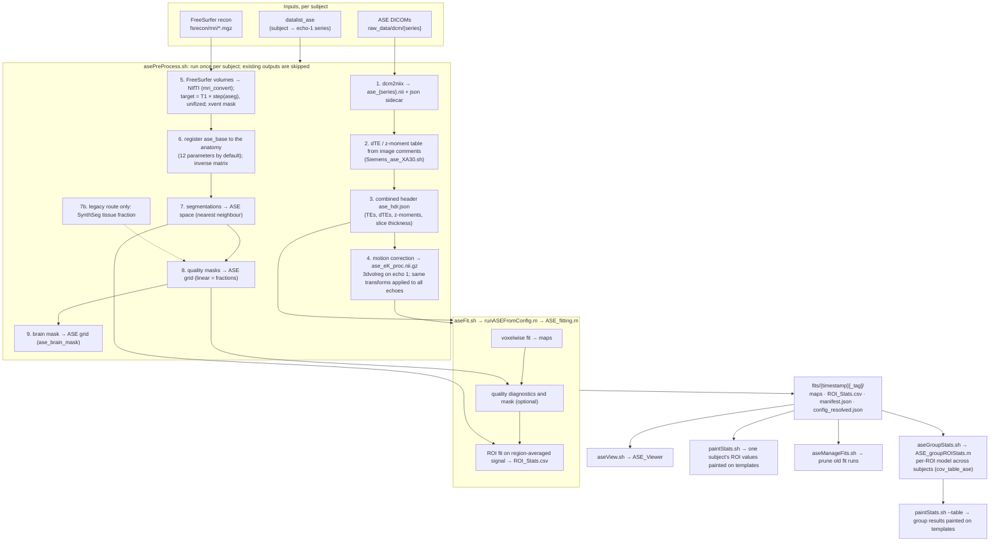
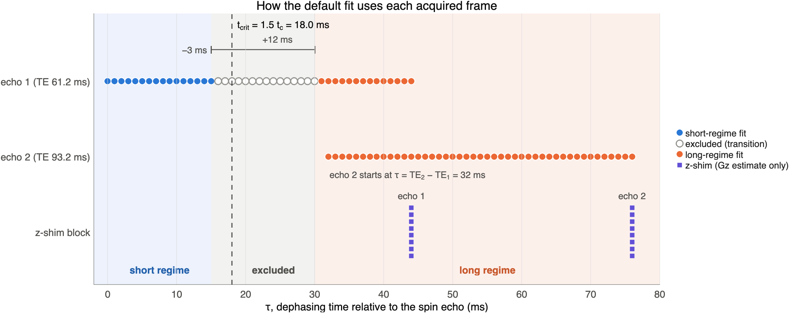
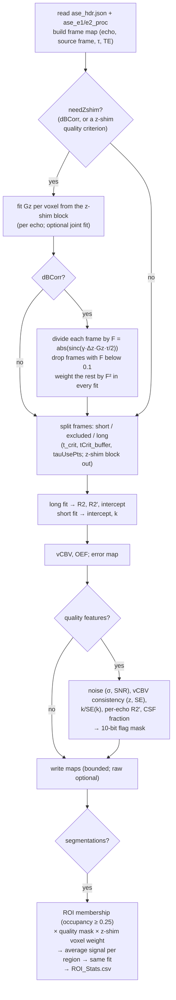

# ASE pipeline: how it works

This page explains, step by step, how raw ASE DICOMs become OEF, R2′, vCBV and R2 maps and ROI tables. For every setting, see [settings.md](settings.md); for every output file, see [outputs.md](outputs.md).

## 1. Overview

**Anatomy.** Since 2026-11-24 the anatomy comes straight from the FreeSurfer recon (`anatSource = fsrecon`): `T1`, `aseg`, `aparc+aseg`, `wmparc` and the brainstem labels, all on FreeSurfer's own grid. The ASE base is registered once to the unifized T1 brain, and the labels are resampled once into ASE space. The old route (`anatSource = afni`) took BOLD-aligned copies from the o2co2 BOLD pipeline's `session_afni_nortc`; it is kept for reproducing old results. Evidence and figures: [anat-route-report.md](anat-route-report.md).

**Settings precedence**, in both shell scripts: script defaults < the config file (`BashFiles/ase_config.json`) < command-line flags.
- Pipeline keys go in the config's `"pipeline"` section.
- Fit options go in the `"fit"` section. Override them with `aseFit.sh --fit key=value`.

## 2. The acquisition, and how frames are used

Each subject has two echo series from **the same excitations**:
- Echo 2 is read out 32 ms after echo 1 in every frame, so both echoes share the same head position (checked from the DICOM acquisition times).
- Each echo has 98 frames: 2 repetitions of a 45-point sweep, plus an 8-frame z-shim block at the end.
- In the sweep, dTE runs from 0 to 44 ms in 1 ms steps.

**τ, the dephasing time**, is the offset from the spin echo: τ = dTE for echo 1 and τ = dTE + 32 ms for echo 2.

The fit splits the frames by τ around t_crit = 1.5 · t_c:

*Figure: every frame of one repetition (each τ is acquired twice), placed on the τ axis and coloured by how the default fit uses it.*
- **Short regime:** echo-1 frames with τ ≤ t_crit − 3 ms.
- **Excluded:** the transition band.
- **Long regime:** τ > t_crit + 12 ms. That covers both echoes; echo 2 lies entirely in the long regime, because its τ starts at TE₂ − TE₁ = 32 ms.
- **Z-shim block:** 8 frames per echo at each echo's longest τ, with different z-moments. Used only to estimate the through-slice gradient Gz; never in the regime fits, including its zero-moment frame.
- Generated by `Scripts/makeDocFigures.m` from the test subject's header.

- **t_c** = 1 / δω, where δω = (4/3)·π·γ·Δχ₀·Hct·(1 − StO2_max)·B0. B0 is the **actual** field from the header (`B0_T` = imaging frequency / 42.5775 MHz/T, e.g. 2.892 T on the Prisma), not the nominal 3 T. With the defaults (Δχ₀ = 0.18 ppm, Hct = 0.42 × 0.85, StO2_max = 0.6) that gives t_c = 12.0 ms and t_crit = 18.0 ms.
- **The excluded band** comes from `tCrit_buffer` = [3, 12]. The short regime ends at t_crit − 3 ms (τ ≤ 15 ms) and the long regime starts at t_crit + 12 ms (τ ≥ 31 ms). The upper side is wider on purpose: when the tissue's true t_c is longer than assumed, the decay is still curving at 20 ms (see [decisions.md](decisions.md)).

## 3. The signal model and the fit

**Long regime** (τ well past t_c), fitted on both echoes:

  ln S = [ln C + vCBV] − R2 · TE − R2′ · τ        (design [1, −TE, −τ])

**Short regime** (τ < t_c), echo 1, after adding back R2·TE from the long fit:

  ln S + R2 · TE = ln C + k · τ²        (design [1, τ²]; k < 0 is expected)

**Derived values:**
- vCBV = long intercept − short intercept
- OEF = R2′ / (vCBV · (4/3)·π·γ·Δχ₀·Hct·B0)
- OEF is set to NaN where vCBV ≤ 0 or R2′ ≤ 0.

All fits are least squares in log space. They run voxel by voxel, and, for the ROI table, again on each region's averaged signal.

## 4. Corrections and diagnostics, all optional

| feature | switch | what it does |
|---|---|---|
| **z-shim (through-slice) correction** | `dBCorr` | Estimates the through-slice field gradient Gz per voxel from the z-shim block, using a sinc slice profile. Divides each frame by its predicted attenuation F. Frames with F < `zshim_Fcut` are dropped; the rest get weight F². ROI averages use one fixed weight per voxel (F² at its worst frame), so every frame averages the same voxel mix. |
| **repetition noise** | `quality.repNoise` | σ from the difference between the two repetitions; SNR = spin-echo signal / σ. |
| **fit extensions** | `quality.fitExtensions` | A second vCBV estimate from the short-regime curvature (vCBV_quad = −0.3·R2′²/k), analytic standard errors, the z-score of the two vCBVs' difference, k/SE(k), and separate R2′ per echo. |
| **quality mask** | `quality.enabled` | Combines the criteria below into a per-voxel 16-bit flag map. Flagged voxels are excluded from ROI averages, and regions left with fewer than `minVoxKept` effective voxels get NaN. |

**Quality criteria** (bit = position in `_qualityFlags`):

| bit | name | flags a voxel when | default threshold | calibrated? |
|---|---|---|---|---|
| 0 | implausible | a raw map is NaN or outside `physBd_*` | bounds | — |
| 1 | quadSign | the short-regime curvature is significantly the wrong sign: k/SE(k) > 2 | 2 | yes (noise rate 2.3%) |
| 2 | vcbvZ | the two vCBV estimates disagree: \|z\| > `vcbvZ_max` | 3 (placeholder) | **no** |
| 3 | lowSNR | min SNR over echoes < `snr_min` | 10 | rarely active |
| 4 | csf | CSF fraction > `csf_max` (CSF = 1 − xvent tissue fraction) | 0.2 | — |
| 5 | vein | vCBV > 4 × the median vCBV of tissue voxels | relative, k = 4 | yes |
| 6 | zshimEdge | the Gz fit hit the grid edge, or the profile peak is outside the sampled moments | — | — |
| 7 | zshimEcho | \|Gz_e1 − Gz_e2\| > `zshimEcho_maxDiff` | 20 µT/m (placeholder) | **no** |
| 8 | zshimFrac | more than 30% of long frames have F < 0.5 | 0.3 | — |
| 9 | r2pEcho | per-echo R2′ F-test p < 0.01 | **off by default** | flags a model effect, not bad voxels |

**Thresholds still to recalibrate on several subjects:** bits 2 and 7. The working "set C" values from the 2026-11-12 calibration (vcbvZ 8.9, zshimEcho 12.7) predate later fit changes. The mask stays off by default until recalibration.

## 5. Where each step lives

| step | file |
|---|---|
| preprocessing, stages 1–8 | `BashFiles/asePreProcess.sh` (dTE comments: `BashFiles/Siemens_ase_XA30.sh`; cohort link tree: `Scripts/linkO2co2Ase.sh`) |
| batch fitting | `BashFiles/aseFit.sh` → `CoreMatFiles/runASEFromConfig.m` → `CoreMatFiles/ASE_fitting.m` |
| header parsing | `Aux_Mat_Functions/readASEHeader.m` |
| log-linear least squares | `CoreMatFiles/fitMultiRegressor.m` |
| z-shim | `CoreMatFiles/fitZshimGradient.m`, `fitZshimGradientJoint.m`, `zshimAttenuation.m` |
| noise, SEs, quality | `Aux_Mat_Functions/estimateRepNoise.m`, `CoreMatFiles/vcbvConsistency.m`, `computeVoxelQuality.m`, `Aux_Mat_Functions/qualityDefaults.m` |
| ROI membership | `Aux_Mat_Functions/segToAseMembership.m`, `combineSegVols.m` |
| viewing / painting / housekeeping | `BashFiles/aseView.sh` (`ASE_Viewer.m`), `paintStats.sh` (`ASE_paintROIStats.m`), `aseManageFits.sh` |
| group statistics | `BashFiles/aseGroupStats.sh` → `CoreMatFiles/ASE_groupROIStats.m` (helpers: `Aux_Mat_Functions/readCovTable.m`, `applyCovFilters.m`, `findFitRun.m`, `bhFDR.m`) |
| analysis scripts | `Scripts/regimeBoundarySim.m` (regime-split bias, with noise), `Scripts/anLin2003DesignFit.m` (An & Lin 2003 design), `Scripts/compareAnatRoutes.m` (anatomy routes, [anat-route-report.md](anat-route-report.md)), `Scripts/makeDocFigures.m` (figures for these docs) |
| tests | `Tests/` (run `runtests('Tests')` with `CoreMatFiles` and `Aux_Mat_Functions` on the path) |
